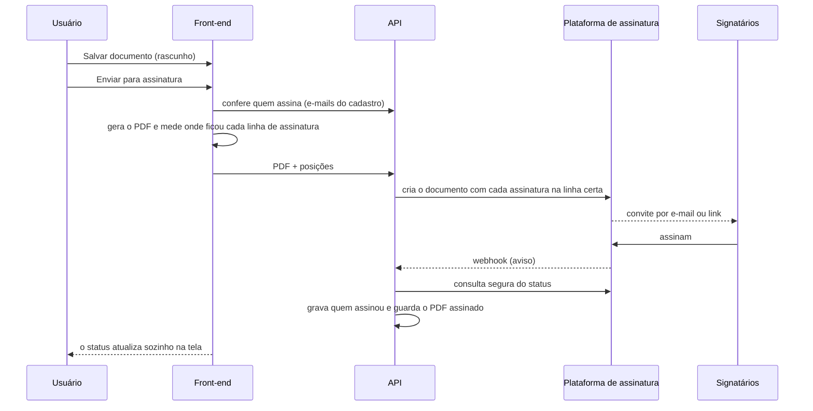
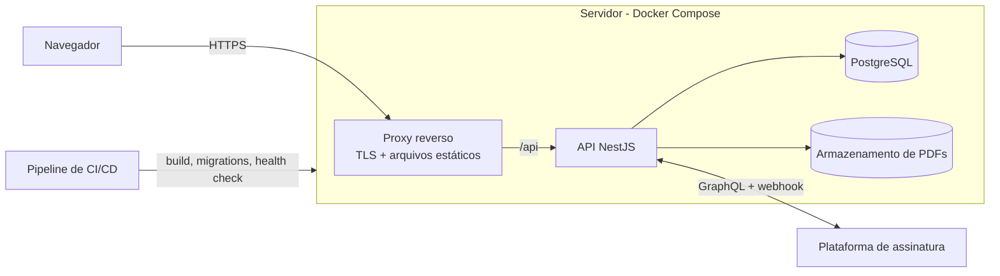

# Sistema de Controle Operacional — SESCINC

> 🛠️ Documentação técnica (instalação, variáveis, API, deploy): veja o **[README.md](README.md)**.

Plataforma web completa para a gestão operacional de um **Serviço de Salvamento e Combate a Incêndio em aeródromo**: escalas, efetivo, registros diários, livro de ocorrências, treinamentos, relatórios e **assinatura eletrônica integrada** — tudo num só lugar, substituindo papel, planilhas e mensagens soltas.

---

## Sobre o projeto

A rotina de um plantão envolve muitos documentos e controles: escala, efetivo do dia, treinamento recorrente, ocorrências do turno, trocas de serviço, livro de registro e relatórios. Feito em papel e planilhas, isso gera retrabalho, erro de digitação, documento perdido e muito tempo gasto com burocracia em vez de operação.

O sistema cobre o ciclo inteiro do plantão:

> **Escala mensal → Escala diária → Treinamento (PTR-BA) → Registros do turno → Livro de Registro de Ocorrências (LRO) → Assinatura eletrônica → Relatórios**

Ele está em produção, com deploy contínuo a cada atualização.

**Atuação no projeto:** idealização, produto, UX/UI, front-end, back-end, banco de dados, infraestrutura e deploy.

---

## Destaques

- **Assinatura eletrônica integrada** — o documento gerado pelo sistema vai direto para assinatura, cada pessoa assina **na própria linha** do formulário e o status volta sozinho para o sistema.
- **Fluxo do plantão de ponta a ponta** — o que é registrado durante o turno vira, automaticamente, o conteúdo do livro de ocorrências e do registro de treinamento.
- **PDFs fiéis aos formulários oficiais**, gerados no navegador.
- **Regras operacionais no código** — substituições, férias, trocas de serviço, cadeia de substituição, validação de cursos por função e horas de instrução por assunto.
- **Segurança** — login com token, permissões verificadas no servidor (não só na tela), auditoria de exclusões e bloqueio de documento já enviado para assinatura.
- **Desempenho medido e corrigido em produção** — a tela mais pesada caiu de **~169 MB para ~26 KB** por carregamento.
- **Deploy automático** — push na branch principal → pipeline de CI → build e migrations no servidor → verificação de saúde pelo commit publicado.

---

## Módulos

### Escalas e efetivo
- **Escala mensal** por equipe e regime de plantões.
- **Escala diária** derivada da mensal, já resolvendo coberturas.
- **Quadro de efetivos** com férias, afastamentos, extras e substituições do dia.
- **Férias** com escala anual, substitutos e relatório mensal em PDF.
- **Substituições temporárias** com aprovação, cadeia de substituição e vigência por função.
- **Trocas de serviço** com formulário, validação e registro automático no livro de ocorrências.

### Registros diários e livro de ocorrências
- **Registro de treinamento recorrente (PTR-BA)** com participantes, situação, instruções, evidências fotográficas e regras de horas por assunto.
- **Ocorrências, inspeções e solicitações** registradas durante o turno.
- **Gerador do livro de ocorrências (LRO)** — assistente que monta o livro com equipagem das viaturas, frota, instruções, trocas, ocorrências e solicitações, puxando o que já foi registrado no plantão.

### Treinamentos e exercícios
- Teste de aptidão física, testes de proficiência e exercícios operacionais, com numeração anual automática e relatórios.
- Certificações e cursos com validade por função e alertas de vencimento.

### Cadastros e materiais
- Pessoal, viaturas, equipamentos, extintores, hidrantes e agentes extintores, com movimentações e relatório mensal.
- Controle de EPIs e checklists operacionais, incluindo modelos personalizáveis.

### Relatórios, estatísticas e auditoria
- Relatórios por módulo, com filtros e impressão.
- Estatísticas operacionais com gráficos.
- Auditoria de exclusões: o que foi excluído, quando e por qual conta.

---

## Estudo de caso: assinatura eletrônica integrada

Os documentos do plantão precisam ser assinados por várias pessoas. Antes, o arquivo era baixado, enviado manualmente para uma plataforma de assinatura e as posições das assinaturas eram arrastadas uma a uma. A integração com uma **API GraphQL de assinatura eletrônica** fez isso virar um clique.



**Problemas resolvidos:**

- **Posição exata da assinatura em documentos de tamanho variável.** O livro de ocorrências pode ter 2 ou 6 páginas. Como o PDF é montado a partir de HTML, o gerador **mede em que página e em que altura** caiu cada linha de assinatura e envia junto; o servidor converte isso nas coordenadas da plataforma. Os deslocamentos foram calibrados em ambiente de testes até a assinatura cair exatamente sobre o traço.
- **Uma assinatura, vários lugares.** Quem aparece em mais de um campo assina uma vez e a assinatura é aplicada em todas as posições.
- **Regras de negócio.** Um documento conta como concluído conforme regras próprias de cada formulário (por exemplo, quando todos os participantes de uma função assinaram), e o responsável que assina é **quem estiver no cargo na data do documento**, considerando férias e substituições.
- **Atualização automática e segura.** O webhook não é tratado como verdade: ele só dispara uma consulta controlada à plataforma, limitada a documentos do próprio sistema, com verificação **HMAC-SHA256**.
- **Imutabilidade.** Documento enviado não pode mais ser editado nem excluído — a regra vale na tela **e** no servidor.
- **Download pronto para entrega.** O PDF completo, com o relatório de auditoria da plataforma, fica guardado e visível no sistema; o download entrega só as páginas do documento.
- **Custo sob controle.** Visualizações e downloads usam o PDF guardado e não consultam a API.
- **Migração do histórico.** Documentos já assinados manualmente foram vinculados automaticamente, casados pelo nome do arquivo e pelos signatários.

---

## Desempenho: de ~169 MB para ~26 KB

Diante de reclamações de lentidão, o caminho foi medir antes de mexer:

1. **Servidor:** CPU e memória ociosos — o gargalo não era a máquina.
2. **Banco:** uma tabela com poucos registros ocupava quase 180 MB — as fotos das evidências estavam dentro do próprio registro.
3. **Tela:** ao abrir, o sistema baixava **todos os registros já feitos, com todas as fotos**.

**Correção:** um endpoint de listagem que devolve os registros **sem as imagens** (com um indicador de foto) e busca **só o período filtrado**. As fotos são carregadas apenas ao abrir o documento, e uma trava impede salvar uma edição sem as fotos carregadas.

| | Antes | Depois |
|---|---|---|
| Abrir a tela de registros | ~169 MB | ~26 KB |
| Estatísticas e relatórios | baixavam todas as fotos | só dados |

Outro ajuste: depois de cada atualização, abas abertas pediam arquivos da versão anterior e mostravam erro. Agora a página **recarrega sozinha** e abre a versão nova.

---

## Arquitetura



- **Front-end:** React + TypeScript + Vite + Tailwind CSS, rotas carregadas sob demanda e camada de serviços por domínio.
- **Back-end:** NestJS com CRUD genérico protegido por política de acesso, endpoints específicos para regras de negócio e guarda global de autenticação.
- **Banco:** PostgreSQL com mais de 70 migrations versionadas, progressivas e sem perda de dados.
- **Infra:** Docker Compose com proxy reverso e HTTPS automático; API e banco em rede interna — o banco nunca fica exposto.
- **CI/CD:** cada push na branch principal dispara o deploy; o script confere que o back-end e o front-end publicados estão **no mesmo commit** antes de considerar o deploy concluído.

---

## Stack

| Camada | Tecnologias |
|---|---|
| Front-end | React, TypeScript, Vite, Tailwind CSS, React Router, Recharts |
| Documentos | jsPDF, pdf-lib, pdf.js, html-to-image |
| Back-end | NestJS, Node.js, Express, Multer, class-validator, bcrypt |
| Banco de dados | PostgreSQL |
| Integrações | API GraphQL de assinatura eletrônica com webhooks (HMAC) |
| Infra / DevOps | Docker, Docker Compose, proxy reverso com HTTPS, CI/CD |
| Qualidade | TypeScript estrito, lint, testes de regras de negócio |

---

## Segurança

- Autenticação por token e **permissões verificadas no servidor**, por função.
- Política de acesso no CRUD genérico: colunas sensíveis nunca saem da API e tabelas restritas exigem perfil administrativo.
- Auditoria de exclusões com a conta autenticada gravada pelo próprio banco, não pelo navegador.
- Segredos apenas em variáveis de ambiente; nada sensível versionado.
- Webhook com verificação HMAC-SHA256 e comparação em tempo constante.
- Banco, API e armazenamento acessíveis apenas pela rede interna dos containers.

---

## Em números

| | |
|---|---|
| ~80 mil linhas | de TypeScript no front-end |
| 30+ telas | cobrindo a operação inteira |
| 70+ migrations | de banco versionadas |
| 2 documentos | com assinatura eletrônica integrada, com os próximos já planejados |

---

## Como rodar localmente

**Pré-requisitos:** Node.js 20+ e Docker.

```bash
# 1. Variáveis de ambiente
cp .env.example .env

# 2. Banco de dados
npm run db:up

# 3. Dependências e migrations
npm install
npm run db:migrate

# 4. Em terminais separados
npm run dev:backend
npm run dev:frontend
```

> No PowerShell do Windows, use `npm.cmd` se `npm` apontar para um `npm.ps1` quebrado.

O front usa `VITE_API_BASE_URL` para falar com a API.

A integração de assinatura eletrônica tem modo de testes (documentos sem valor jurídico e sem custo) e modo simulado (sem chamar a API externa), configurados por variável de ambiente.

### Comandos úteis

| Comando | O que faz |
|---|---|
| `npm run build` | Build do back-end e do front-end |
| `npm run typecheck` | Checagem de tipos dos dois lados |
| `npm run lint` | Lint dos dois lados |
| `npm run test:exercicios` | Testes da numeração de exercícios |
| `npm run test:ptrba-apoc` | Testes de regras do registro de treinamento |
| `npm run test:auditoria` | Testes da auditoria de exclusões |
| `npm run prod:up` | Sobe a stack de produção com Docker Compose |

---

## Estrutura

```
.
├── frontend/              # React + Vite
│   └── src/
│       ├── pages/         # telas por domínio
│       ├── components/    # layout, UI e componentes compartilhados
│       ├── services/      # acesso à API e geração de PDFs
│       └── hooks/ types/ utils/ lib/
├── backend/               # NestJS
│   ├── src/
│   │   ├── auth/          # login, tokens e permissões
│   │   ├── resources/     # CRUD protegido por política + endpoints específicos
│   │   ├── (assinatura)/  # integração de assinatura eletrônica
│   │   └── storage/       # armazenamento de arquivos
│   └── database/migrations/
├── deploy/                # script de deploy e configuração do proxy
├── .github/workflows/     # deploy automático
└── docker-compose*.yml
```

---

## O que aprendi

- **Medir antes de otimizar.** A lentidão não estava no servidor, e sim em centenas de megabytes de imagens trafegando a cada clique.
- **Regra de negócio mora no servidor.** Esconder um botão não é segurança; toda trava importante foi replicada na API.
- **Integrar com terceiros exige desconfiança saudável.** O webhook é só um aviso — a verdade vem de uma consulta controlada.
- **Software para operação precisa falar a língua da operação.** Muitas decisões vieram de conversar com quem usa o sistema no dia a dia.

---

## Licença

**© 2026 — Todos os direitos reservados.**

Este projeto é proprietário. **Não é permitido copiar, modificar, distribuir, hospedar ou usar este código, no todo ou em parte, sem autorização prévia e por escrito do autor.** Veja o arquivo [LICENSE](LICENSE).
