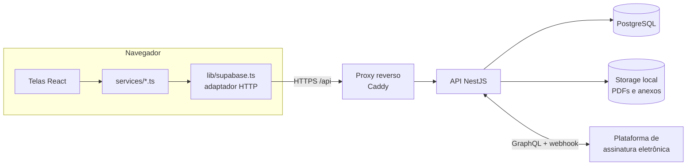

# Sistema de Controle Operacional — SESCINC

**Um sistema feito para quem está de plantão.**

Plataforma web que organiza toda a rotina de um Serviço de Salvamento e Combate a Incêndio em aeródromo: quem está de serviço hoje, quem cobre quem, o que foi treinado, o que aconteceu no turno, o livro de ocorrências, os documentos para assinar e os relatórios que a empresa pede no fim do mês.

> 📄 Visão de produto e estudos de caso técnicos: **[PORTFOLIO.md](PORTFOLIO.md)**

---

## Sumário

- [Por que o sistema existe](#por-que-o-sistema-existe)
- [Um plantão dentro do sistema](#um-plantão-dentro-do-sistema)
- [O que cada área faz](#o-que-cada-área-faz)
- [Regras que o sistema cuida sozinho](#regras-que-o-sistema-cuida-sozinho)
- [Assinatura eletrônica](#assinatura-eletrônica)
- [Quem usa e o que cada um vê](#quem-usa-e-o-que-cada-um-vê)
- [Cuidados com os dados](#cuidados-com-os-dados)
- [Parte técnica](#parte-técnica)

---

## Por que o sistema existe

Um plantão de bombeiros de aeródromo gera muita papelada: escala, efetivo do dia, trocas de serviço, férias, substituições, treinamento recorrente com lista de presença e fotos, ocorrências, inspeções, livro de registro, testes físicos, exercícios e relatórios mensais. Tudo isso precisa estar correto, assinado e entregue no prazo.

Feito em papel, planilhas e mensagens, isso significa:

- o chefe de equipe gastando o plantão com burocracia em vez de operação;
- a mesma informação digitada várias vezes, em lugares diferentes;
- documento perdido, assinatura faltando e relatório fechado no último dia;
- ninguém sabendo ao certo quem está cobrindo quem.

O sistema junta tudo isso num só lugar. **A informação é registrada uma vez, no momento em que acontece, e reaproveitada em todos os documentos que dependem dela.**

---

## Um plantão dentro do sistema

Assim é o dia a dia de uma equipe usando o sistema:

**1. A escala já está pronta.**
A escala mensal é gerada por equipe, seguindo o regime de plantões. A escala diária nasce dela, já considerando férias, afastamentos, trocas e substituições aprovadas. O chefe abre o sistema e vê quem está de serviço e em qual função.

**2. O efetivo do dia aparece no quadro.**
O quadro de efetivos mostra a equipe completa, quem está de férias, quem foi substituído e por quem, e quem está fazendo extra — com o motivo de cada mudança.

**3. O treinamento é registrado com presença e evidências.**
No PTR-BA (treinamento recorrente), a lista de participantes já vem montada a partir da equipe do dia. O instrutor marca a situação de cada um, escolhe os assuntos ministrados, anexa as fotos e salva. As horas de cada pessoa por assunto são contadas automaticamente para os relatórios.

**4. O que acontece no turno é anotado na hora.**
Ocorrências, BONA/REA, inspeções e solicitações são registradas durante o plantão, cada uma com seu horário.

**5. O livro de ocorrências se monta sozinho.**
Ao gerar o LRO, o assistente puxa a equipagem das viaturas, a frota, as instruções, as trocas de serviço e tudo o que foi registrado no turno. O chefe revisa, complementa e salva.

**6. Os documentos vão para assinatura com um clique.**
PTR-BA e LRO são enviados para assinatura eletrônica direto do sistema. Cada pessoa recebe o pedido por e-mail (ou por um link enviado no WhatsApp), assina no celular, e a assinatura aparece na linha certa do documento. O card do documento muda de cor sozinho conforme as pessoas assinam.

**7. No fim do mês, os relatórios já estão prontos.**
Relatórios de treinamento, ocorrências, exercícios, substituições, trocas e férias saem filtrados por mês e equipe, prontos para imprimir ou baixar em PDF.

---

## O que cada área faz

### 🏠 Dashboard
A visão geral do plantão: indicadores operacionais, alertas de vencimento (cursos, certificações) e atalhos para o que precisa de atenção.

### 📅 Escalas
- **Escala mensal** gerada por equipe, respeitando o regime de plantões.
- **Escala diária** derivada da mensal, com coberturas resolvidas.
- **Quadro de efetivos** com a equipe do dia, extras, férias e substituições.

### 👥 Funcionários
- **Cadastro do efetivo** com função, equipe, turno, contatos, cursos e documentos de habilitação.
- **Substituições temporárias** com pedido, aprovação, cadeia de substituição (quem cobre quem cobre) e vigência por função.
- **Férias** com escala anual, substitutos e relatório mensal em PDF.
- **EPIs** e **certificações/cursos**, com validade e alerta antes de vencer.
- **Validação de cursos por função**: o sistema avisa quando alguém é colocado numa função para a qual não tem o curso exigido.

### 📝 Registros diários
- **PTR-BA** — treinamento recorrente com participantes, situação (presente, ausente, instrutor...), assuntos, horários e evidências fotográficas. A tela abre leve: as fotos só carregam quando o documento é aberto.
- **Ocorrências**, **BONA/REA**, **inspeções** e **solicitações** do turno.
- **Checklists** operacionais, incluindo modelos personalizáveis com linhas e colunas editáveis.

### 📖 Livro de Registro de Ocorrências (LRO)
- Assistente em etapas que monta o livro a partir do que já foi registrado no plantão.
- Salvo como **rascunho** até ser enviado para assinatura.
- Ao ser enviado, as ocorrências que entraram no livro são fechadas e o livro fica protegido contra alterações.

### 🎓 Treinamentos e exercícios
- **TAF** (teste de aptidão física), **TP/EPR**, **Exercício de Posicionamento** e **Tempo Resposta**.
- Numeração anual automática, sem números repetidos.
- Equipagem das viaturas e comunicante já preenchidos a partir da escala.

### 📂 Documentos
- **Trocas de serviço (permuta)** com formulário, validação e registro no livro de ocorrências. A troca é entre bombeiros; APOC não aparece na lista.
- **Ordens de serviço**, com número interno e número do cliente, e consulta pública.
- **Agentes extintores** com movimentações, testes e relatório mensal.
- **Modelos de documentos** para preenchimento.

### 🚒 Cadastros
Pessoal, viaturas (com histórico de panes), equipamentos, extintores, hidrantes e agentes extintores.

### 📊 Relatórios e estatísticas
- Relatórios de LRO, PTR-BA, BONA/REA, exercícios, substituições, trocas e férias, com filtros por mês, ano e equipe.
- Estatísticas com gráficos de treinamento e operação.

### 🔎 Auditoria
Toda exclusão fica registrada: o que foi excluído, quando e por qual conta. Só administradores consultam.

### 🎬 Tutorial
Um tutorial animado mostra a rotina do plantão dentro do sistema, e cada tela tem um guia passo a passo para quem está começando.

---

## Regras que o sistema cuida sozinho

São as regras que antes dependiam da memória de alguém:

| Situação | O que o sistema faz |
|---|---|
| **Regime de plantões** | Sabe quais equipes estão de serviço em cada dia e o horário de entrada e saída de cada turno |
| **Férias e substituições** | Mostra quem está cobrindo quem, em qual função e por quanto tempo |
| **Cadeia de substituição** | Quando o substituto também é substituído, a cadeia é acompanhada até o fim |
| **Curso exigido por função** | Avisa quando a pessoa não tem o curso necessário para a função em que foi colocada |
| **Horas de treinamento** | Conta as horas de cada pessoa por assunto, inclusive as regras específicas de quem é de apoio |
| **Numeração de exercícios** | Gera o próximo número do ano sem repetir, mesmo com duas pessoas salvando ao mesmo tempo |
| **Responsável que assina** | Para o livro de ocorrências, quem assina como gerente é quem estava no cargo **na data do plantão**, considerando férias e substituições |
| **Documento enviado** | Depois de ir para assinatura, não pode mais ser editado nem excluído |
| **Vencimentos** | Avisa antes de cursos, certificações e documentos vencerem |

---

## Assinatura eletrônica

O PTR-BA e o LRO são assinados eletronicamente, sem imprimir nada.

**Para quem envia**
1. Salva o documento (ele fica como rascunho).
2. Em *Ver detalhes*, clica em **Enviar para assinatura**.
3. Confere a lista de quem vai assinar, com o e-mail do cadastro de cada um, e confirma.

**Para quem assina**
- Recebe um e-mail (ou um link pelo WhatsApp, enviado por quem está cobrando a assinatura).
- Abre no celular ou no computador e assina.
- A assinatura aparece **na própria linha** do formulário — inclusive quando a mesma pessoa precisa assinar em dois lugares.

**No sistema**

| Cor do card | Situação |
|---|---|
| sem cor | Rascunho, ainda não enviado |
| 🟠 laranja | Aguardando assinaturas |
| 🟢 verde | Assinado |
| 🔴 vermelho | Alguém recusou |

- O card muda sozinho conforme as pessoas assinam; não é preciso recarregar a página.
- **Ver documento** mostra o PDF assinado completo, com o relatório de auditoria da assinatura.
- **Baixar** entrega o documento pronto para o relatório da empresa, **sem** o relatório de auditoria: o PTR-BA sai só com a 1ª página, e o LRO com todas as páginas do livro.
- Quem cobra a assinatura pode **reenviar o aviso** por e-mail ou mandar o **link pelo WhatsApp**.
- Só administradores podem cancelar um envio; o documento volta a ser rascunho para corrigir e enviar de novo.

---

## Quem usa e o que cada um vê

| Perfil | O que faz no sistema |
|---|---|
| **Desenvolvedor / Administrador** | Tudo: cadastros, usuários, permissões, auditoria, cancelamento de envios e arquivamento |
| **Gerente** | Acompanha a operação, aprova e assina documentos |
| **Chefe de equipe** | Conduz o plantão: escala do dia, PTR-BA, LRO, envio para assinatura |
| **Líder** | Apoia o chefe nos registros do plantão |
| **Bombeiro** | Consulta escalas e registros, participa e assina os documentos |
| **Sem função** | Conta recém-criada aguardando a liberação de um administrador |

Novas contas entram por **convite**. As permissões são conferidas no servidor — esconder um botão na tela não é a única barreira.

---

## Cuidados com os dados

- Login com senha protegida e sessão com prazo de validade.
- Cada perfil só acessa o que precisa; regras importantes valem também no servidor.
- Toda exclusão fica registrada na auditoria.
- Documentos assinados ficam guardados no servidor, com o registro de quem assinou e quando.
- O banco de dados não fica exposto na internet; todo acesso passa por HTTPS.

---

## Parte técnica

<details open>
<summary><b>Arquitetura</b></summary>



- **Monorepo** com dois *workspaces*: `frontend/` (React + Vite) e `backend/` (NestJS).
- O front fala com a API por um adaptador no estilo *query builder* (`lib/supabase.ts`); as telas nunca acessam o banco direto.
- A API tem **guarda global de autenticação**, um **CRUD genérico** em `/api/data/:table` limitado a tabelas permitidas e protegido por política de acesso, e **endpoints específicos** para as regras de negócio.
- Arquivos (PDFs, anexos) ficam num volume local, com links assinados para download.

</details>

<details>
<summary><b>Stack</b></summary>

| Camada | Tecnologias |
|---|---|
| Front-end | React 19, TypeScript, Vite 8, Tailwind CSS 4, React Router 7, Recharts, Lucide |
| Documentos | jsPDF, pdf-lib, pdf.js, html-to-image |
| Back-end | NestJS 11, Express, Multer, class-validator, bcryptjs |
| Banco | PostgreSQL 16 |
| Infra | Docker, Docker Compose, Caddy (HTTPS automático) |
| CI/CD | GitHub Actions (deploy por SSH a cada push na `main`) |

</details>

<details>
<summary><b>Instalação e execução local</b></summary>

**Requisitos:** Node.js 20+ e Docker.

```bash
cp .env.example .env        # configure as variáveis
npm run db:up               # PostgreSQL + pgAdmin
npm install
npm run db:migrate          # aplica as migrations
npm run create-admin --workspace=backend   # primeiro administrador

# em terminais separados
npm run dev:backend
npm run dev:frontend
```

| Serviço | Endereço padrão |
|---|---|
| Front-end | `http://localhost:5173` |
| API | `http://localhost:3333/api` (`/api/health` para checar) |
| pgAdmin | `http://localhost:5050` |

> No PowerShell do Windows, use `npm.cmd` se `npm` apontar para um `npm.ps1` quebrado.

</details>

<details>
<summary><b>Variáveis de ambiente</b></summary>

Modelos em `.env.example` (local) e `.env.production.example` (produção). Nunca commite os arquivos `.env` reais.

| Variável | Para que serve |
|---|---|
| `POSTGRES_DB`, `POSTGRES_USER`, `POSTGRES_PASSWORD`, `POSTGRES_PORT` | Banco de dados |
| `DATABASE_URL` | Conexão da API com o banco |
| `NODE_ENV`, `PORT`, `API_PREFIX` | Execução da API |
| `FRONTEND_ORIGIN` | Origens permitidas no CORS |
| `PUBLIC_API_URL` | URL pública da API (links de arquivos) |
| `STORAGE_PATH` | Pasta dos PDFs e anexos |
| `JWT_SECRET` | Segredo das sessões (mínimo 32 caracteres) |
| `VITE_API_BASE_URL` | Endereço da API visto pelo navegador |
| `AUTENTIQUE_TOKEN` | Chave da API de assinatura eletrônica |
| `AUTENTIQUE_MODO` | `simulado` (sem chamar a API), `sandbox` (testes sem custo) ou vazio (produção) |
| `AUTENTIQUE_WEBHOOK_SECRET` | Segredo do webhook de assinatura |
| `APP_SITE_ADDRESS` | Domínio para o HTTPS em produção |
| `PGADMIN_*` | Acesso ao pgAdmin local |

</details>

<details>
<summary><b>Scripts</b></summary>

| Script | O que faz |
|---|---|
| `npm run dev:frontend` / `dev:backend` | Desenvolvimento |
| `npm run build` | Build da API e do front |
| `npm run typecheck` / `lint` | Tipos e lint dos dois lados |
| `npm run db:up` / `db:down` / `db:migrate` | Banco local e migrations |
| `npm run test:exercicios` | Numeração de exercícios |
| `npm run test:ptrba-apoc` | Regras de horas no PTR-BA |
| `npm run test:auditoria` | Auditoria de exclusões |
| `npm run prod:up` / `prod:down` / `prod:migrate` / `prod:logs` | Stack de produção |

</details>

<details>
<summary><b>API</b></summary>

Rotas sob `/api`, com `Authorization: Bearer <token>` (exceto as públicas).

| Rota | Descrição |
|---|---|
| `GET /health` | Saúde da API e commit publicado *(pública)* |
| `POST /auth/login`, `GET /auth/me` | Login e sessão |
| `GET /auth/convite/:codigo`, `POST /auth/register-convite` | Cadastro por convite *(públicas)* |
| `POST /data/:table/{query,insert,update,delete}` | CRUD genérico protegido por política |
| `POST /rpc/:name` | Operações transacionais |
| `GET /ptrba/resumo` | PTR-BA sem fotos, filtrado por período e equipe |
| `GET /auditoria/exclusoes` | Histórico de exclusões *(admin)* |
| `/storage/:bucket/{upload,list,remove,signed-url,file}` | Arquivos |
| `GET /public/ordens-servico` | Consulta pública *(pública)* |
| `/autentique/envios` (+ `previa`, `:id/atualizar`, `:id/reenviar`, `:id/pdf`, `:id/cancelar`, `:id/signatarios/:sid/link`) | Envio e acompanhamento de assinaturas |
| `POST /autentique/webhook` | Aviso da plataforma de assinatura *(pública, verificada por HMAC)* |

Contrato completo entre front e API: [`API_ENDPOINTS.md`](API_ENDPOINTS.md).

</details>

<details>
<summary><b>Banco de dados e migrations</b></summary>

- Migrations SQL numeradas em `backend/database/migrations/`, aplicadas por `npm run db:migrate` (controle em `schema_migrations`).
- O deploy aplica as migrations automaticamente.
- Mudanças devem ser **progressivas e sem perda de dados**; nunca edite uma migration que já rodou em produção.

</details>

<details>
<summary><b>Deploy</b></summary>

Produção em Docker Compose (`docker-compose.prod.yml`): **Caddy** (HTTPS e front-end), **API** e **PostgreSQL** em rede interna, com volumes persistentes para o banco, os arquivos e os certificados.

A cada push na `main`, o GitHub Actions (`.github/workflows/deploy-oracle.yml`) conecta na VM, atualiza o código para o commit do push, faz o build, aplica as migrations, recria os containers e **confere que a API e o front publicados estão no mesmo commit** — senão o deploy falha. O `.env.production` fica só na VM. Primeira instalação: [`DEPLOY_ORACLE.md`](DEPLOY_ORACLE.md).

Nunca exponha o PostgreSQL, o pgAdmin, a API direta ou o Docker daemon; todo acesso externo passa pelo Caddy em `80/443`.

</details>

<details>
<summary><b>Estrutura de pastas</b></summary>

```
.
├── frontend/src/
│   ├── pages/         # telas por área
│   ├── components/    # layout, UI e componentes compartilhados
│   ├── services/      # acesso à API e geração de PDFs
│   ├── hooks/ types/ utils/ lib/ routes/
├── backend/
│   ├── database/migrations/
│   ├── scripts/       # migrate, create-admin, testes
│   └── src/           # auth, resources, autentique, auditoria, storage, rpc, public, health
├── deploy/            # script de deploy e Caddyfile
├── .github/workflows/ # deploy automático
├── API_ENDPOINTS.md   # contrato front ↔ API
├── AGENTS.md          # regras do sistema e do domínio
└── PORTFOLIO.md       # visão de produto e estudos de caso
```

</details>

<details>
<summary><b>Solução de problemas</b></summary>

| Sintoma | Solução |
|---|---|
| `npm` não roda no PowerShell | Use `npm.cmd` |
| Login cai a cada reinício da API | Defina um `JWT_SECRET` com 32+ caracteres |
| `ECONNREFUSED` na porta 5432 | Abra o Docker e rode `npm run db:up` |
| "Failed to fetch dynamically imported module" | Aba aberta antes de uma atualização; a página recarrega sozinha |
| Assinatura não atualiza no ambiente local | O webhook aponta para produção; use **Atualizar assinaturas** |
| LRO não envia por férias do gerente | Cadastre o substituto nas férias |

</details>

---

## Licença

**© 2026 — Todos os direitos reservados.**

Este projeto é proprietário. **Não é permitido copiar, modificar, distribuir, hospedar ou usar este código, no todo ou em parte, sem autorização prévia e por escrito do autor.** Veja o arquivo [LICENSE](LICENSE).
